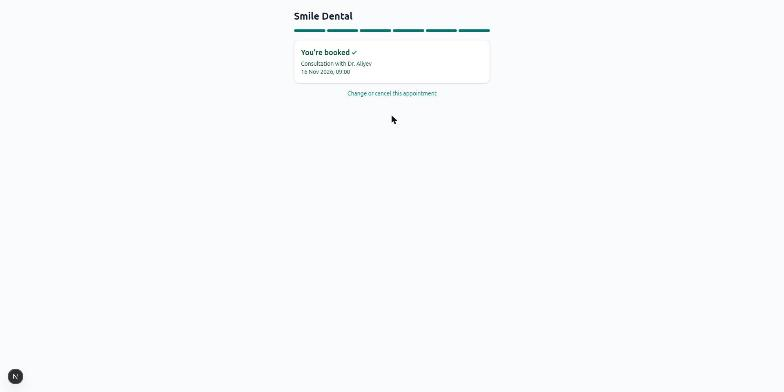
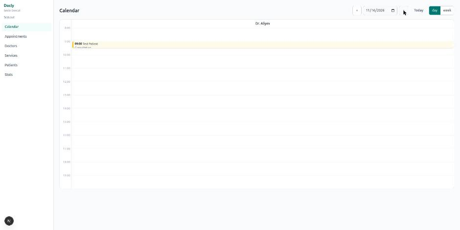
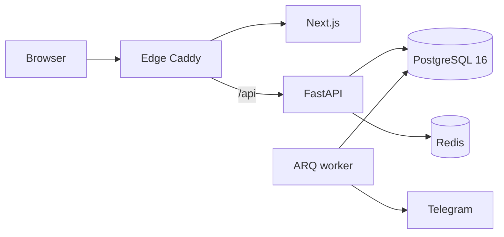

# Docly

Multi-tenant appointment SaaS for private clinics (Uzbekistan). Many clinics register, each sees only its own data, patients book online with a phone OTP, and reminders go out via Telegram.

**Problem:** clinics manage appointments by phone and paper: double bookings, no-shows, no view of doctor load.

## Features
- Public booking `/{clinic_slug}`: service → doctor → date → slot → name/phone → OTP → confirmation; friendly handling when a slot is just taken; patients can cancel/reschedule via a signed link.
- Staff dashboard: day/week calendar, appointments with status changes, doctors (services, multi-interval working hours, time off), services, patients + history, stats (per-day volume, no-show rate, busiest doctors).
- Superadmin: list clinics, suspend/activate.
- Telegram reminders 24 h and 2 h before (idempotent, inline Confirm/Cancel), linked via signed deep link.
- Roles owner / admin / doctor, JWT access + rotating hashed refresh tokens with reuse detection, audit log, Redis rate limits, JSON logs with request_id, `/health`, `/ready`.

| Public booking | Staff calendar |
|---|---|
|  |  |

## Architecture
See [docs/ARCHITECTURE.md](docs/ARCHITECTURE.md) (components, ER, sequence diagrams).


## Design decisions
- **Double booking: DB exclusion constraint, not app locks.** `EXCLUDE USING gist (doctor_id WITH =, during WITH &&) WHERE status IN ('booked','confirmed')`. Correct under any concurrency and any client; violation → `409 SLOT_TAKEN`. A per-doctor advisory lock only removes deadlocks that parallel inserts can cause (found by the race test).
- **Tenancy in two layers:** scoped repositories (clinic_id from the JWT, never the body) + PostgreSQL RLS (`FORCE`, `SET LOCAL app.current_clinic_id` per transaction, app connects as a non-superuser). An explicit `system_session()` is the audited escape hatch.
- **Timezones:** everything stored in UTC (`tstzrange`); working hours are local wall-clock times in the clinic timezone (default Asia/Tashkent); slots computed per local date.
- **ARQ + Redis** for reminders: claim-then-send with `UNIQUE(appointment_id, kind)`, row lock, current-state re-read; reschedule clears old notifications.
- **Limitations:** slot grid = service duration; localStorage tokens (XSS trade-off); at-most-once reminders on a crash between claim and send; real SMS/Telegram not exercised (see docs/BLOCKERS.md); no automated frontend tests; not deployed to a public server.

## Run locally (one command)
```bash
./scripts/dev.sh        # starts Postgres+Redis, migrates, seeds, runs API :8000 and web :3000
```
Open http://localhost:3000/smile-dental (booking; the demo OTP code is shown on screen) and http://localhost:3000/login (`owner@smile.example` / `demo-password-123`, fake seed data). API docs: http://localhost:8000/docs.

## Tests
```bash
cd backend && uv sync && uv run ruff check . && uv run mypy app && uv run pytest -q   # needs Docker (testcontainers: real Postgres + Redis)
cd frontend && pnpm install && pnpm exec tsc --noEmit && pnpm lint && pnpm build
```

## Load test (local, indicative)
Locust, 50 users, 60 s, one uvicorn worker, Postgres/Redis in Docker on the same laptop (rate limits raised).

| Endpoint | Requests | Failures | p50 | p95 | p99 |
|---|---|---|---|---|---|
| GET /public/{slug}/availability | 1907 | 0 | 16 ms | 33 ms | 87 ms |
| GET /public/{slug} | 425 | 0 | 14 ms | 76 ms | 100 ms |
| POST booking (201 or 409) | 137 | 0 | 25 ms | 44 ms | 91 ms |
| **All** | **2743** | **0** | **15 ms** | **38 ms** | **92 ms** |

Throughput (~46 req/s) is bounded by simulated think time, not server capacity.

## More
[PROGRESS](docs/PROGRESS.md) · [DECISIONS](docs/DECISIONS.md) · [RUNBOOK](docs/RUNBOOK.md) · [DEPLOY](docs/DEPLOY.md) · [BLOCKERS](docs/BLOCKERS.md) · Uzbek study guide: [docs/uz/LEARN.md](docs/uz/LEARN.md)
