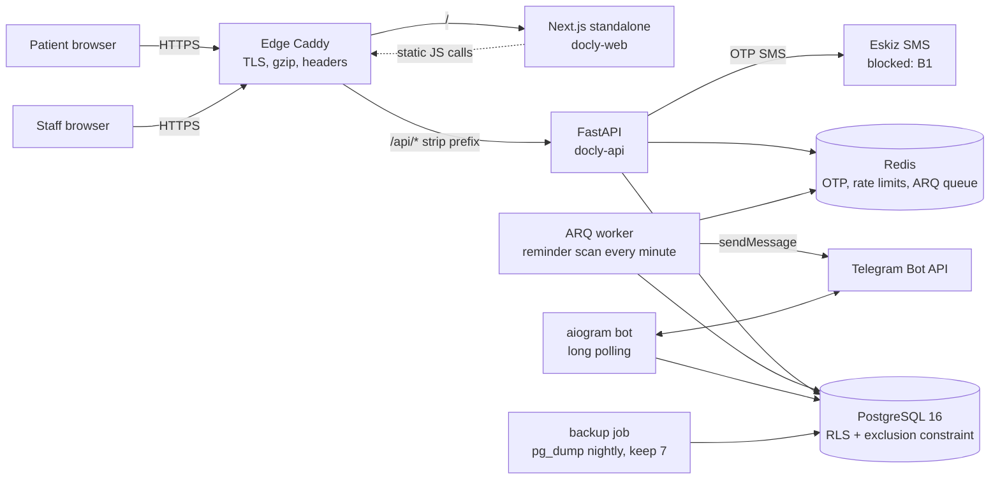

# ARCHITECTURE

## Components


## Data model (ER)
```mermaid
erDiagram
  clinics ||--o{ clinic_memberships : has
  users ||--o{ clinic_memberships : "belongs via"
  users ||--o{ refresh_tokens : owns
  clinics ||--o{ doctors : has
  clinics ||--o{ services : has
  doctors ||--o{ doctor_services : provides
  services ||--o{ doctor_services : "provided by"
  doctors ||--o{ working_hours : "weekday intervals"
  doctors ||--o{ time_off : "tstzrange"
  clinics ||--o{ patients : "unique(clinic_id, phone)"
  doctors ||--o{ appointments : "EXCLUDE gist(doctor_id =, during &&)"
  patients ||--o{ appointments : books
  services ||--o{ appointments : for
  appointments ||--o{ notifications : "unique(appointment_id, kind)"
  clinics ||--o{ audit_log : records
  clinics { uuid id PK; text slug UK; text timezone; bool is_active }
  appointments { uuid id PK; uuid clinic_id; tstzrange during; enum status }
```
Every business table carries `clinic_id` and has `ENABLE + FORCE ROW LEVEL SECURITY`.

## Two-layer tenancy (request path)
```mermaid
sequenceDiagram
  participant B as Browser
  participant API as FastAPI dependency
  participant DB as PostgreSQL
  B->>API: GET /doctors (Bearer JWT)
  API->>API: decode JWT -> Principal(clinic_id, role)  [never from body]
  API->>DB: BEGIN; set_config('app.current_clinic_id', clinic, true)
  API->>DB: SELECT ... WHERE clinic_id = :cid  (ScopedRepo, layer 1)
  Note over DB: RLS policy also filters by app.current_clinic_id (layer 2)
  DB-->>API: rows of this clinic only
  API-->>B: 200 (COMMIT clears the setting)
```

## Public booking (race-safe)
```mermaid
sequenceDiagram
  participant P as Patient
  participant API
  participant R as Redis
  participant DB as PostgreSQL
  P->>API: POST /public/{slug}/otp {phone}
  API->>R: rate-limit, store sha256(code) TTL 5 min; send via OtpSender
  P->>API: POST /public/{slug}/bookings {slot, phone, name, code}
  API->>R: verify code (single use, 5 attempts)
  API->>DB: BEGIN (tenant scoped); availability check (hours - time off - appointments, clinic tz)
  API->>DB: pg_advisory_xact_lock(doctor)
  API->>DB: upsert patient; SAVEPOINT; INSERT appointment
  alt slot free
    DB-->>API: ok -> 201 + manage token (+ Telegram deep link)
  else lost the race
    DB-->>API: 23P01 exclusion violation (or 40P01 deadlock)
    API-->>P: 409 SLOT_TAKEN
  end
```

## Reminders
```mermaid
sequenceDiagram
  participant W as ARQ cron (every minute)
  participant DB as PostgreSQL
  participant T as Telegram
  W->>DB: candidates: active appts, patient linked, start in [now+lead-tol, now+lead]
  loop each candidate
    W->>DB: BEGIN; SELECT ... FOR UPDATE SKIP LOCKED (re-read current state)
    W->>DB: INSERT notification ON CONFLICT (appointment_id, kind) DO NOTHING
    alt claimed
      W->>T: sendMessage + [Confirm][Cancel]
      W->>DB: set sent_at; COMMIT   (on failure: delete claim -> retried next minute)
    else already claimed/sent
      W->>DB: ROLLBACK (skip)
    end
  end
```
Reschedule deletes the appointment's notification rows, so the new time gets fresh reminders and the old time can never fire.
